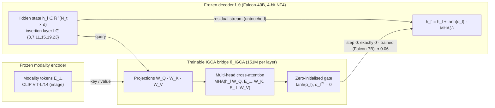
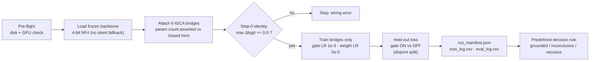

<div align="center">

# Zero-Gated Cross-Attention (IGCA)
### Exact-Identity Multimodal Bridges for Frozen Billion-Scale Language Models

**Basavaraj R M** · **Manav Verma**

[](https://arxiv.org/abs/2611.01116)
[](https://pytorch.org/)
[](#-results)
[-2EA44F?style=for-the-badge)](#-verified-in-this-repository)
[](#-results)
[-0A66C2?style=for-the-badge&logo=pytest&logoColor=white)](#-quickstart)
[](LICENSE)

[**Paper**](https://arxiv.org/abs/2611.01116) · [**Quickstart**](#-quickstart) · [**Results**](#-results) · [**Architecture**](#-architecture) · [**Notes on v1**](#-notes-on-arxiv-v1) · [**Citation**](#-citation)

</div>

---

> [!IMPORTANT]
> **In one paragraph.** Plugging a new modality into a frozen language model with a standard cross-attention adapter can perturb decoder representations at initialisation, so early training is spent undoing random noise and any later gain is confounded with recovery from that shock. **IGCA** scales each cross-attention update by a learnable gate $\tanh(\alpha_l)$ with $\alpha_l^{(0)}=0$, so the augmented model is **bit-identical** to the frozen backbone at initialisation; the learned gate then controls how much multimodal information enters during adaptation. Six IGCA bridges (**906M trainable parameters**) on a frozen, 4-bit **Falcon-40B** with CLIP ViT-L/14 image tokens lowered best held-out captioning loss from **4.3469 → 2.2201 nats (−48.9%)** (as reported in arXiv v1) with a gate of only $|\tanh\alpha| = 0.0713$, and the identity at initialisation is **0.00e+00, not "close to zero"**, verified on Falcon, LLaMA and BLOOM architectures by the test suite in this repository.

---

## ✨ Highlights

| | |
|---|---|
| 🔒 **Bit-exact identity at init** | $\alpha_l^{(0)}=0 \Rightarrow h'_l = h_l$. Asserted as `== 0.0` (not a tolerance) before any training, on three decoder families. |
| 🧊 **40B-scale, fully frozen** | Falcon-40B in 4-bit NF4 with `PagedAdamW8bit`; only the bridges train. Each bridge is placed on the GPU of the layer it hooks, so `device_map="auto"` sharding just works. |
| 🎯 **Verified on Falcon-7B, 5 seeds** | Exact 0.00e+00 identity at initialisation on every seed; −50.5% held-out loss, matching an un-gated adapter with ~5× lower seed-to-seed spread ([results](#-results)). |
| 🧪 **Ablation built in** | `--variant ungated` runs the standard adapter of Eq. (1) under identical settings, isolating the effect of the gate. |
| 🔌 **Backbone-agnostic hooks** | Auto-discovers decoder stacks for Falcon, BLOOM, LLaMA/OpenLLaMA/Mistral/Qwen, OPT, GPT-NeoX and MPT, with no model surgery. |
| 🧾 **Audit-ready runs** | Every run writes `run_manifest.json`, per-step `loss_log.csv` and `eval_log.csv`; a predefined decision rule labels each run *grounded / inconclusive / vacuous*. |
| 💻 **Laptop-verifiable in about 1 minute** | `python falcon_local.py --tiny-random` reproduces the identity and a grounding effect on CPU with no downloads. |

---

## 🏗 Architecture

### 1 · The IGCA residual bridge



### 2 · Run pipeline: every new experiment is traceable



### 3 · Where IGCA sits in the broader grounding system

```mermaid
flowchart TD
    Mod["Multimodal inputs"] --> Enc["Frozen modality encoders E_⊥"]
    Enc --> IGCA["IGCA bridges into frozen LLM specialists"]

    subgraph Verified["REPOSITORY-VERIFIED: tests in this repo"]
        Init["Exact step-0 identity: 0.00e+00"]
        Acct["Parameter accounting · gradient isolation"]
        Toy["Synthetic grounding test"]
    end

    subgraph Reported["REPORTED IN ARXIV V1: raw logs not archived"]
           The Falcon-40B held-out figures in arXiv v1 (−48.9%) could not be reproduced from the v1 code (its held-out split was empty), so they are not used as results; see [ERRATA.md](ERRATA.md). The logged Falcon-7B runs above supersede them. A Falcon-40B re-run with the same v1.1 pipeline is planned for arXiv v2.

    subgraph Proposed["PROPOSED SYSTEM: design, not yet evaluated"]
        Ctrl["Agentic controller<br/>reason · retrieve · inspect"]
        Fuse["Bayesian candidate fusion<br/>ω_i ∝ exp(β · s(r_i, X))"]
        Ver["Self-verification loop"]
    end

    IGCA --> Init
    IGCA --> Acct
    IGCA --> Toy
    IGCA --> Loss
    Loss -.-> Ctrl
    Ctrl -.-> Fuse
    Fuse -.-> Ver
```

---

## 📐 Method

**The problem with un-gated adapters.** A standard bridge adds

$$h_l^{\text{std}} = h_l + \mathrm{MHA}(h_l W_Q,\, E_\perp W_K,\, E_\perp W_V),$$

which is non-zero at step 0 because the projections are random. Stacked over several layers, it pushes activations off the backbone's pretrained manifold before any learning has happened.

**IGCA** gates the update with a learnable scalar per layer:

$$h_l' = h_l + \tanh(\alpha_l)\,\mathrm{MHA}(h_l W_Q,\, E_\perp W_K,\, E_\perp W_V), \qquad \alpha_l^{(0)} = 0 \;\Rightarrow\; h_l' = h_l .$$

The gate also closes the gradient path to $W_Q, W_K, W_V$ at step 0 (only $\alpha_l$ receives gradient on the first update), so the bridge opens smoothly instead of injecting noise. Only $\theta_{\text{IGCA}} = \{\alpha_l, W_Q^{(l)}, W_K^{(l)}, W_V^{(l)}, W_O^{(l)}\}$ is trained:

$$\mathcal{L} = -\log P(r^* \mid \mathcal{X}, q) \;+\; \mu \lVert\theta_{\text{IGCA}}\rVert_2^2 .$$

**Parameter accounting.** One bridge with decoder width $H$ and modality width $D$ has $2H^2 + 2HD + 4H + 1$ parameters (Q, K, V and output projections, biases, gate):

| Backbone | $H$ | Layers | IGCA layers | Per bridge | **Total (6 bridges)** |
|---|---:|---:|---|---:|---:|
| **Falcon-40B** | 8192 | 60 | 3, 7, 11, 15, 19, 23 | 151,027,713 | **906,166,278** |
| Falcon-7B | 4544 | 32 | 3, 7, 11, 15, 19, 23 | 50,620,161 | 303,720,966 |
| BLOOM-7b1 | 4096 | 30 | 3, 7, 11, 15, 19, 23 | 41,959,425 | 251,756,550 |
| Falcon-RW-1B | 2048 | 24 | 3, 7, 11, 15, 19, 23 | 12,591,105 | 75,546,630 |

Reproduce any row offline with `python igca.py --count tiiuae/falcon-40b`.

> [!NOTE]
> **Lineage.** The tanh-gated, zero-initialised cross-attention principle was introduced by **Flamingo** (Alayrac et al., 2022). IGCA isolates that principle as a stand-alone mechanism and studies it on a **frozen, 4-bit, 40B-parameter decoder**, with bit-exact identity verification, an explicit un-gated ablation and an audit trail for every run.

---

## 📊 Results

### ✅ Verified v1.1 results (Falcon-7B, Flickr8k, 5 seeds)

Frozen **Falcon-7B** (4-bit NF4) + CLIP ViT-L/14, six IGCA bridges (layers 3, 7, 11, 15, 19, 23; 303.7M trainable parameters).
Training: 6,000 steps = one full pass over the 6,000 Flickr8k training captions (batch 1). Held-out: 200 captions from the separate Flickr8k validation split, evaluated every 500 steps.
Hardware: 2 × Tesla T4 (Kaggle), code commit `3997ef6`, 10 runs, 8.4 GPU-hours. Every number below comes from `runs/*/run_manifest.json` and `runs/*/eval_log.csv` (`python summarize_runs.py runs`).

Held-out loss in nats (lower is better). Frozen Falcon-7B: **3.8355**. Mean ± standard deviation over seeds 0–4.

| Variant | Change at step 0 | Best held-out | Held-out at step 6,000 | Gain vs frozen |
|---|:-:|:-:|:-:|:-:|
| **Gated IGCA** (tanh(α), α = 0) | **0.0000 ± 0.0000** | **1.8986 ± 0.0134** | **1.8999 ± 0.0132** | **50.5 ± 0.4%** |
| Un-gated adapter (same bridges, no gate) | +0.4956 ± 0.2200 | 1.9070 ± 0.0313 | 1.9540 ± 0.0725 | 50.3 ± 0.8% |

**What this shows**

- **Exact identity at initialisation (5/5 seeds):** the gated bridge leaves Falcon-7B's output unchanged (max logit difference 0.00e+00). The un-gated adapter worsens held-out loss by +0.20 to +0.80 nats before training.
- **Same final quality:** both variants roughly halve the held-out loss. The difference in best held-out loss is not significant (−0.008 nats, paired t-test p = 0.63, 3/5 seeds favour gated).
- **More consistent across seeds:** the spread of the final held-out loss is about 5× smaller with the gate (SD 0.013 vs 0.073). Gated runs did not get worse after their best point; un-gated runs rose by up to +0.16 nats late in training.
- **Trade-off:** the un-gated adapter learns faster at first (step 500: 2.23 vs 2.38, 5/5 seeds). The gate starts closed and opens slowly (final gate ≈ 0.06).

The held-out figures in arXiv v1 (Falcon-40B, −48.9%) could not be traced to a run and are withdrawn; see [ERRATA.md](ERRATA.md). These Falcon-7B results replace them. Falcon-40B has not been re-run.

| Seed | Gated best | Un-gated best | Gated step 6,000 | Un-gated step 6,000 | Un-gated step-0 shift |
|:-:|:-:|:-:|:-:|:-:|:-:|
| 0 | 1.9169 | 1.9115 | 1.9169 | 1.9503 | +0.4290 |
| 1 | 1.8890 | 1.9085 | 1.8890 | 2.0733 | +0.7964 |
| 2 | 1.8942 | 1.9544 | 1.9011 | 1.9544 | +0.2049 |
| 3 | 1.8848 | 1.8913 | 1.8848 | 1.8913 | +0.4444 |
| 4 | 1.9079 | 1.8695 | 1.9079 | 1.9006 | +0.6035 |


### Evidence boundary

| Outcome | Status |
|---|---|
| Matched ablation: frozen vs un-gated vs IGCA (Falcon-7B, 5 seeds) | ✅ done, logs in `runs/` |
| Falcon-40B held-out loss (arXiv v1) | ⚠️ not verified: superseded by the Falcon-7B runs |
| Matched Falcon-40B ablation (gated vs un-gated) | ⏳ planned for arXiv v2 |
| OpenLLaMA / BLOOM checkpoints | 🛠️ hooks tested on both layouts; runs pending |
| Audio / video encoders · downstream VQA or hallucination benchmarks · latency | ⏳ design scope |

---

## 🚀 Quickstart

```bash
git clone https://github.com/Basavarajearlybird/IGCA-Zero-Gated-Cross-Attention
cd IGCA-Zero-Gated-Cross-Attention
pip install -r requirements.txt
```

**1 · Verify on any laptop (CPU, about 1 minute)**
```bash
pytest -q                                              # 21 tests
python falcon_local.py --tiny-random                   # IGCA: exact identity + grounding
python falcon_local.py --tiny-random --variant ungated # un-gated baseline for contrast
python igca.py --count tiiuae/falcon-40b               # 906,166,278 trainable parameters
```

**2 · Real backbone + Flickr8k (GPU)**
```bash
pip install bitsandbytes
python falcon_local.py --model tiiuae/falcon-7b  --data flickr8k --steps 2000
python falcon_local.py --model tiiuae/falcon-40b --data flickr8k --steps 6000                   # IGCA
python falcon_local.py --model tiiuae/falcon-40b --data flickr8k --steps 6000 --variant ungated  # ablation
```

**3 · Notebook** – [`igca_falcon40b.ipynb`](igca_falcon40b.ipynb) runs the full Falcon-40B experiment (pre-flight → load → identity check → train → evaluate → manifest). Falcon-40B needs about 85 GB of disk and roughly 25–30 GB of GPU memory in 4-bit (backbone plus bridges and optimiser state).

Windows: `powershell -ExecutionPolicy Bypass -File run_local.ps1`.

Each run writes `runs/<model>_<variant>_<time>/` containing `run_manifest.json`, `loss_log.csv`, `eval_log.csv` and the best bridge checkpoint.

---

## 🗂 Repository

```text
IGCA-Zero-Gated-Cross-Attention/
├── igca.py                 # IGCALayer, IGCABridge (hooks), exact identity check, parameter accounting CLI
├── igca_pipeline.py        # Flickr8k + CLIP data, disjoint held-out eval, optimiser, run logger, decision rule
├── falcon_local.py         # One script from CPU (--tiny-random) to multi-GPU Falcon-40B
├── igca_falcon40b.ipynb    # End-to-end Falcon-40B notebook (Kaggle / Colab / workstation)
├── run_local.ps1           # Windows launcher
├── tests/test_igca.py      # 21 CPU tests: identity on 3 architectures, gradients, accounting, pipeline
├── ERRATA.md               # Reconciliation with arXiv v1
├── CITATION.cff · LICENSE · requirements.txt
```

---

## 🧭 Roadmap

- [x] **Matched ablation on Falcon-7B (5 seeds)**: see [Results](#-results)
- [ ] **Falcon-40B re-run: gated vs un-gated, several seeds, 6,000 steps** (planned for arXiv v2). Runs as-is on a ≥ 48 GB GPU:
- [ ] Validation-based checkpoint selection with a single final evaluation on the untouched Flickr8k test split
- [ ] All five captions per image (30,000 pairs) and FP32 adapter master weights
- [ ] OpenLLaMA and BLOOM backbones; audio (Whisper) and video (VideoMAE v2) encoders
- [ ] Downstream grounding benchmarks (captioning metrics, VQA, hallucination probes)
- [ ] Integration with retrieval, Bayesian candidate fusion and self-verification (Eq. 4)

---

## 📝 Notes on arXiv v1

Short reconciliation (details in [ERRATA.md](ERRATA.md)). The IGCA mechanism is unchanged. The Falcon-40B held-out figures in v1 are not verified (the v1 held-out split was empty) and are superseded by the logged Falcon-7B runs in [Results](#-results). A Falcon-40B re-run is planned for arXiv v2.
| v1 | Correct | |
|---|---|---|
| 40,404,961,288 trainable parameters | **906,166,278** | transcription error; `python igca.py --count tiiuae/falcon-40b` |
| Average improvement 1.9075 nats | **2.0925 nats** | arithmetic (4.3423 − 2.2498) |
| Training data not named | Flickr8k captions, CLIP ViT-L/14 | train loss 0.0007 reflects about 10 epochs on 6,000 captions |
| Flamingo not cited | Gating principle credited to Alayrac et al. (2022) | see *Lineage* above |

---

## 📚 Citation

```bibtex
@article{rm2026igca,
  title   = {Zero-Gated Cross-Attention},
  author  = {{Basavaraj R M} and Verma, Manav},
  journal = {arXiv preprint arXiv:2611.01116},
  year    = {2026},
  doi     = {10.48550/arXiv.2611.01116}
}
```

**Built on** Flamingo (Alayrac et al., 2022) for the gated cross-attention principle; Falcon (TII), CLIP (OpenAI) and Flickr8k (Hodosh et al., 2013) for models and data.

<div align="center">

*IGCA: add a modality without disturbing what the model already knows.*

</div>
