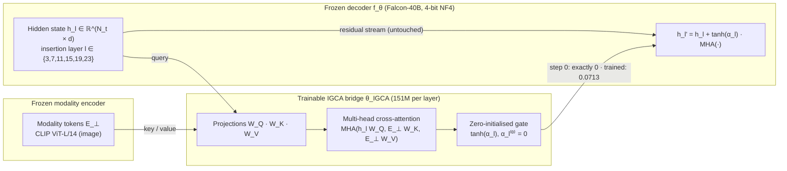
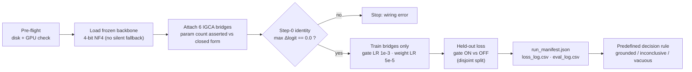
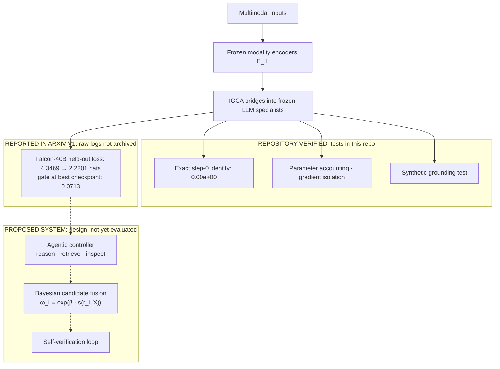

<div align="center">

# Zero-Gated Cross-Attention (IGCA)
### Exact-Identity Multimodal Bridges for Frozen Billion-Scale Language Models

**Basavaraj R M** · **Manav Verma**

[](https://arxiv.org/abs/2611.01116)
[](https://pytorch.org/)
[](#-results)
[-2EA44F?style=for-the-badge)](#-verified-in-this-repository)
[-8A2BE2?style=for-the-badge)](#-results)
[-0A66C2?style=for-the-badge&logo=pytest&logoColor=white)](#-quickstart)
[](LICENSE)

[**Paper**](https://arxiv.org/abs/2611.01116) · [**Quickstart**](#-quickstart) · [**Results**](#-results) · [**Architecture**](#-architecture) · [**Notes on v1**](#-notes-on-arxiv-v1) · [**Citation**](#-citation)

</div>

---

> [!IMPORTANT]
> **In one paragraph.** Plugging a new modality into a frozen language model with a standard cross-attention adapter can perturb decoder representations at initialisation, so early training is spent undoing random noise and any later gain is confounded with recovery from that shock. **IGCA** scales each cross-attention update by a learnable gate $\tanh(\alpha_l)$ with $\alpha_l^{(0)}=0$, so the augmented model is **bit-identical** to the frozen backbone at initialisation; the learned gate then controls how much multimodal information enters during adaptation. Six IGCA bridges (**906M trainable parameters**) on a frozen, 4-bit **Falcon-40B** with CLIP ViT-L/14 image tokens lowered best held-out captioning loss from **4.3469 → 2.2201 nats (−48.9%)** (as reported in arXiv v1) with a gate of only $|\tanh\alpha| = 0.0713$, and the identity at initialisation is **0.00e+00, not "close to zero"**, verified on Falcon, LLaMA and BLOOM architectures by the test suite in this repository.

---

## ✨ Highlights

| | |
|---|---|
| 🔒 **Bit-exact identity at init** | $\alpha_l^{(0)}=0 \Rightarrow h'_l = h_l$. Asserted as `== 0.0` (not a tolerance) before any training, on three decoder families. |
| 🧊 **40B-scale, fully frozen** | Falcon-40B in 4-bit NF4 with `PagedAdamW8bit`; only the bridges train. Each bridge is placed on the GPU of the layer it hooks, so `device_map="auto"` sharding just works. |
| 🎯 **Strong signal from a nearly-closed gate** | −2.13 nats held-out with mean $\lvert\tanh\alpha\rvert = 0.0713$ (arXiv v1 report): the frozen decoder is conditioned gently, not overwritten. |
| 🧪 **Ablation built in** | `--variant ungated` runs the standard adapter of Eq. (1) under identical settings, isolating the effect of the gate. |
| 🔌 **Backbone-agnostic hooks** | Auto-discovers decoder stacks for Falcon, BLOOM, LLaMA/OpenLLaMA/Mistral/Qwen, OPT, GPT-NeoX and MPT, with no model surgery. |
| 🧾 **Audit-ready runs** | Every run writes `run_manifest.json`, per-step `loss_log.csv` and `eval_log.csv`; a predefined decision rule labels each run *grounded / inconclusive / vacuous*. |
| 💻 **Laptop-verifiable in about 1 minute** | `python falcon_local.py --tiny-random` reproduces the identity and a grounding effect on CPU with no downloads. |

---

## 🏗 Architecture

### 1 · The IGCA residual bridge



### 2 · Run pipeline: every new experiment is traceable



### 3 · Where IGCA sits in the broader grounding system



---

## 📐 Method

**The problem with un-gated adapters.** A standard bridge adds

$$h_l^{\text{std}} = h_l + \mathrm{MHA}(h_l W_Q,\, E_\perp W_K,\, E_\perp W_V),$$

which is non-zero at step 0 because the projections are random. Stacked over several layers, it pushes activations off the backbone's pretrained manifold before any learning has happened.

**IGCA** gates the update with a learnable scalar per layer:

$$h_l' = h_l + \tanh(\alpha_l)\,\mathrm{MHA}(h_l W_Q,\, E_\perp W_K,\, E_\perp W_V), \qquad \alpha_l^{(0)} = 0 \;\Rightarrow\; h_l' = h_l .$$

The gate also closes the gradient path to $W_Q, W_K, W_V$ at step 0 (only $\alpha_l$ receives gradient on the first update), so the bridge opens smoothly instead of injecting noise. Only $\theta_{\text{IGCA}} = \{\alpha_l, W_Q^{(l)}, W_K^{(l)}, W_V^{(l)}, W_O^{(l)}\}$ is trained:

$$\mathcal{L} = -\log P(r^* \mid \mathcal{X}, q) \;+\; \mu \lVert\theta_{\text{IGCA}}\rVert_2^2 .$$

**Parameter accounting.** One bridge with decoder width $H$ and modality width $D$ has $2H^2 + 2HD + 4H + 1$ parameters (Q, K, V and output projections, biases, gate):

| Backbone | $H$ | Layers | IGCA layers | Per bridge | **Total (6 bridges)** |
|---|---:|---:|---|---:|---:|
| **Falcon-40B** | 8192 | 60 | 3, 7, 11, 15, 19, 23 | 151,027,713 | **906,166,278** |
| Falcon-7B | 4544 | 32 | 3, 7, 11, 15, 19, 23 | 50,620,161 | 303,720,966 |
| BLOOM-7b1 | 4096 | 30 | 3, 7, 11, 15, 19, 23 | 41,959,425 | 251,756,550 |
| Falcon-RW-1B | 2048 | 24 | 3, 7, 11, 15, 19, 23 | 12,591,105 | 75,546,630 |

Reproduce any row offline with `python igca.py --count tiiuae/falcon-40b`.

> [!NOTE]
> **Lineage.** The tanh-gated, zero-initialised cross-attention principle was introduced by **Flamingo** (Alayrac et al., 2022). IGCA isolates that principle as a stand-alone mechanism and studies it on a **frozen, 4-bit, 40B-parameter decoder**, with bit-exact identity verification, an explicit un-gated ablation and an audit trail for every run.

---

## 📊 Results

### Falcon-40B (arXiv:2611.01116)

| Metric | Gate-off (frozen Falcon-40B) | **IGCA (gate-on)** | Δ |
|---|:---:|:---:|---|
| Step-0 max output difference | — | **0.00e+00** | exact algebraic no-op |
| **Best held-out loss** | 4.3469 | **2.2201** | **−2.1268 nats (−48.9%)** |
| Average held-out loss | 4.3423 | 2.2498 | −2.0925 nats (−48.2%) ✱ |
| Mean gate at best checkpoint | 0 | 0.0713 | gentle conditioning |
| Training loss (59,500 updates) | — | 3.9403 → 0.0007 | ≈ 9.9 epochs over 6,000 Flickr8k image–caption pairs (`caption_0`) ✱ |
| Trainable parameters | 0 | 906,166,278 | 6 × 151,027,713 ✱ |
| Setup | — | — | Flickr8k captions · CLIP ViT-L/14 · batch 1 · seq 48 · `PagedAdamW8bit` |

✱ corrected or clarified relative to arXiv v1; see [Notes on arXiv v1](#-notes-on-arxiv-v1). Figures in this table are as reported in v1; the original run's raw logs were not archived.

### ✅ Verified in this repository

Run on CPU in about a minute, with no downloads, using random-initialised backbones (`pytest -q`, `python falcon_local.py --tiny-random`). These checks validate the mechanism and the wiring, not the performance of pretrained checkpoints:

| Check | Result |
|---|---|
| Step-0 identity, IGCA, on **Falcon, LLaMA and BLOOM** decoder layouts | **0.00e+00** (bit-exact) |
| Step-0 perturbation, **un-gated** adapter (Eq. 1), same seed | 5.34e-01 max logit change |
| Gradient isolation | backbone gradients `None`; at α = 0 only the gate receives gradient |
| Parameter formula vs PyTorch `nn.MultiheadAttention` | exact match, including 151,027,713 per Falcon-40B bridge |
| Toy grounding task (modality-only answer), 300 steps | held-out **6.961 → 2.663 nats**; gate opens 0 → 0.752; matches the un-gated final loss (2.657) **while keeping the exact identity at init** |

### Evidence boundary

| Outcome | Status |
|---|---|
| Step-0 identity, held-out loss (Falcon-40B) | ✅ reported |
| Matched Falcon-40B ablation: frozen vs un-gated vs IGCA | 🛠️ code complete and executable on large GPUs (`--variant ungated`); run pending |
| OpenLLaMA / BLOOM checkpoints | 🛠️ hooks tested on both layouts; runs pending |
| Audio / video encoders · downstream VQA or hallucination benchmarks · latency | ⏳ design scope |

---

## 🚀 Quickstart

```bash
git clone https://github.com/Basavarajearlybird/IGCA-Zero-Gated-Cross-Attention-
cd IGCA-Zero-Gated-Cross-Attention-
pip install -r requirements.txt
```

**1 · Verify on any laptop (CPU, about 1 minute)**
```bash
pytest -q                                              # 21 tests
python falcon_local.py --tiny-random                   # IGCA: exact identity + grounding
python falcon_local.py --tiny-random --variant ungated # un-gated baseline for contrast
python igca.py --count tiiuae/falcon-40b               # 906,166,278 trainable parameters
```

**2 · Real backbone + Flickr8k (GPU)**
```bash
pip install bitsandbytes
python falcon_local.py --model tiiuae/falcon-7b  --data flickr8k --steps 2000
python falcon_local.py --model tiiuae/falcon-40b --data flickr8k --steps 59500                    # IGCA
python falcon_local.py --model tiiuae/falcon-40b --data flickr8k --steps 59500 --variant ungated  # ablation
```

**3 · Notebook** – [`igca_falcon40b.ipynb`](igca_falcon40b.ipynb) runs the full Falcon-40B experiment (pre-flight → load → identity check → train → evaluate → manifest). Falcon-40B needs about 85 GB of disk and roughly 25–30 GB of GPU memory in 4-bit (backbone plus bridges and optimiser state).

Windows: `powershell -ExecutionPolicy Bypass -File run_local.ps1`.

Each run writes `runs/<model>_<variant>_<time>/` containing `run_manifest.json`, `loss_log.csv`, `eval_log.csv` and the best bridge checkpoint.

---

## 🗂 Repository

```text
IGCA-Zero-Gated-Cross-Attention/
├── igca.py                 # IGCALayer, IGCABridge (hooks), exact identity check, parameter accounting CLI
├── igca_pipeline.py        # Flickr8k + CLIP data, disjoint held-out eval, optimiser, run logger, decision rule
├── falcon_local.py         # One script from CPU (--tiny-random) to multi-GPU Falcon-40B
├── igca_falcon40b.ipynb    # End-to-end Falcon-40B notebook (Kaggle / Colab / workstation)
├── run_local.ps1           # Windows launcher
├── tests/test_igca.py      # 21 CPU tests: identity on 3 architectures, gradients, accounting, pipeline
├── ERRATA.md               # Reconciliation with arXiv v1
├── CITATION.cff · LICENSE · requirements.txt
```

---

## 🧭 Roadmap

- [ ] **Matched Falcon-40B ablation: frozen vs un-gated vs IGCA** (same data, seed, budget). Code is complete and runs as-is on a ≥ 30 GB GPU:
      `python falcon_local.py --model tiiuae/falcon-40b --data flickr8k --steps 59500 --variant ungated`
- [ ] Validation-based checkpoint selection with a single final evaluation on the untouched Flickr8k test split
- [ ] All five captions per image (30,000 pairs) and FP32 adapter master weights
- [ ] OpenLLaMA and BLOOM backbones; audio (Whisper) and video (VideoMAE v2) encoders
- [ ] Downstream grounding benchmarks (captioning metrics, VQA, hallucination probes)
- [ ] Integration with retrieval, Bayesian candidate fusion and self-verification (Eq. 4)

---

## 📝 Notes on arXiv v1

Short reconciliation (details in [ERRATA.md](ERRATA.md)). The IGCA mechanism is unchanged. The Falcon-40B figures are kept as reported in v1; the original logs were not archived, so v1.1 provides a corrected, fully logged pipeline for new runs.

| v1 | Correct | |
|---|---|---|
| 40,404,961,288 trainable parameters | **906,166,278** | transcription error; `python igca.py --count tiiuae/falcon-40b` |
| Average improvement 1.9075 nats | **2.0925 nats** | arithmetic (4.3423 − 2.2498) |
| Training data not named | Flickr8k captions, CLIP ViT-L/14 | train loss 0.0007 reflects about 10 epochs on 6,000 captions |
| Flamingo not cited | Gating principle credited to Alayrac et al. (2022) | see *Lineage* above |

---

## 📚 Citation

```bibtex
@article{rm2026igca,
  title   = {Zero-Gated Cross-Attention},
  author  = {{Basavaraj R M} and Verma, Manav},
  journal = {arXiv preprint arXiv:2611.01116},
  year    = {2026},
  doi     = {10.48550/arXiv.2611.01116}
}
```

**Acknowledgements.** Flamingo (Alayrac et al., 2022) for the gated cross-attention principle; Falcon (TII), CLIP (OpenAI) and Flickr8k (Hodosh et al., 2013) for models and data.

<div align="center">

*IGCA: add a modality without disturbing what the model already knows.*

</div>
